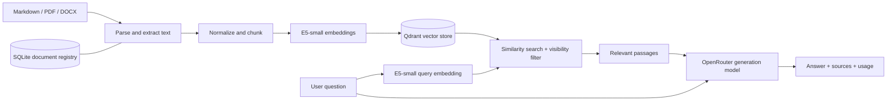

# MicroBot — MicroClub Document Assistant

MicroBot is a document-grounded assistant for MicroClub. It retrieves relevant passages from an ingested corpus, sends those passages to a language model, and returns an answer with source information. When it cannot find sufficiently relevant context, it is designed to say that it does not know instead of inventing an answer.


## Features

- Ingest Markdown, PDF, and DOCX documents through the API.
- Extract text from scanned PDFs using OCRmyPDF and Tesseract.
- Split documents into overlapping, structure-aware chunks.
- Embed document passages and user questions with `intfloat/multilingual-e5-small` using Sentence Transformers.
- Search vectors with Qdrant, with visibility filtering for public and member content.
- Generate grounded responses through OpenRouter. The repository currently configures `google/gemma-4-31b-it:free` as the generation model.
- Manage documents through admin-protected endpoints.
- Record request IDs, latency, retrieval grounding status, and model token usage in structured logs.
- Run locally with Docker Compose or as a Python application.

## Project presentation

[Open the MicroBot presentation on Canva](https://canva.link/ogmmnixu8jyqz4l).

## Screenshots

### Grounded answer about MicroClub sections

The local Swagger UI returned a grounded answer with the `sections` document among its sources.


### Grounded answer about MicroClub's mission

The local Swagger UI returned a grounded answer based on the `about` document.


## Architecture



SQLite tracks document metadata and ingestion status. Qdrant stores searchable chunk vectors and their payloads. They serve different purposes: a document listed as ready in SQLite should still be checked in Qdrant and in chat sources when validating retrieval.

## Key design choices

| Choice | Why it is used | Trade-off |
| --- | --- | --- |
| **FastAPI** | Provides typed request validation and an OpenAPI/Swagger interface for trying the endpoints. | The API process still needs enough memory for the embedding model and document processing. |
| **E5-small** | A multilingual sentence-embedding model used for semantic retrieval. The implementation adds `passage:` to document text and `query:` to questions, as expected by E5. | It is smaller than many embedding models, but still consumes RAM when loaded. Retrieval quality depends on the corpus, chunk boundaries, and the configured threshold. |
| **Chunk size 800 / overlap 120** | Keeps passages small enough for focused retrieval while overlap preserves context across chunk boundaries. Headings and paragraphs are kept together where possible. | These are character-based defaults, not a guarantee that every semantic section fits perfectly. |
| **Qdrant** | Stores vectors with metadata and supports similarity search filtered by document visibility. It can run locally or connect to Qdrant Cloud. | Cloud Qdrant stores and searches vectors; it does not run E5 or reduce the API container's RAM use. |
| **SQLite registry** | A simple persistent record of uploaded documents, their visibility, status, and content hash. | On Render, local SQLite data is on the service filesystem unless a persistent volume is configured. The current free deployment can lose local data after restarts. |
| **OpenRouter** | Provides an OpenAI-compatible chat-completions endpoint and allows the generation model to be configured through environment variables. | Free model providers may be busy or rate-limited; the API can return `429`. |
| **Render Free** | Selected solely because the plan is free. | The free instance has constrained RAM, can spin down when idle, and uses ephemeral storage. The project has observed health-check timeouts and instance recovery events. |
| **Docker Compose** | Gives a repeatable local setup and keeps system dependencies such as OCR and Chromium inside the image. | The first image build is large and downloads dependencies and the E5-small model, so it requires time, disk space, and network access. |

## Requirements

### Docker (recommended)

- Docker Desktop or Docker Engine with the Compose plugin.
- Internet access for the first image build, which installs dependencies and downloads the E5-small model.

### Native Python setup

- Python 3.12 (the Docker image is based on Python 3.12).
- System OCR tools for scanned PDFs: Tesseract with English, French, and Arabic language data, plus the OCRmyPDF PDF utilities such as Ghostscript and qpdf.
- Chromium installed through Playwright if using the rendered-page parser.

Docker is the simpler option because the Dockerfile installs the OCR tools, Playwright Chromium, Python dependencies, and the configured embedding model.

## Configuration

Copy the example file and set your own credentials:

```powershell
Copy-Item .env.example .env
```

Edit `.env` locally. Never commit or share it. `.env` is ignored by Git; `.env.example` contains placeholders and non-secret defaults.
Replace the example member and admin credentials before using document management or member access.

| Variable | Purpose | Default / notes |
| --- | --- | --- |
| `OPENROUTER_API_KEY` | API credential for answer generation. | Required for grounded requests that reach the language model. The API can start without it. |
| `OPENROUTER_MODEL` | OpenRouter generation model ID. | `google/gemma-4-31b-it:free` |
| `OPENROUTER_BASE_URL` | OpenRouter-compatible API base URL. | `https://openrouter.ai/api/v1` |
| `EMBEDDING_MODEL` | Sentence Transformers model used for document and query vectors. | `intfloat/multilingual-e5-small` |
| `MEMBER_TOKEN` | Bearer token that enables member-level retrieval. | Set a private, unique value. |
| `ADMIN_API_KEY` | Protects document upload, listing, and deletion. | Set a private, unique value distinct from `MEMBER_TOKEN`. |
| `QDRANT_URL` | Qdrant server or Qdrant Cloud URL. | Empty means local Qdrant at `VECTOR_STORE_PATH`. |
| `QDRANT_API_KEY` | Credential for Qdrant Cloud or a secured Qdrant server. | Keep secret; used with `QDRANT_URL`. |
| `DATABASE_PATH` | SQLite document registry location. | `data/registry.sqlite3` |
| `VECTOR_STORE_PATH` | Local Qdrant persistence path when `QDRANT_URL` is empty. | `data/qdrant` |
| `CHUNK_SIZE` | Maximum target chunk size in characters. | `800` |
| `CHUNK_OVERLAP` | Character overlap for long chunks. | `120`; must be smaller than `CHUNK_SIZE`. |
| `RETRIEVAL_THRESHOLD` | Minimum similarity score accepted for retrieval. | `0.79` |
| `MAX_UPLOAD_BYTES` | Maximum uploaded file size. | `10485760` (10 MiB) |
| `LLM_DAILY_REQUEST_LIMIT` | Application-level daily successful-call allowance. | `50` |
| `LLM_TIMEOUT_SECONDS` | Timeout for a provider request. | `30` |
| `APP_PORT` | Host port published by Docker Compose. | `8000`; set to `8001` if port 8000 is occupied. |

When `QDRANT_URL` is configured, both ingestion and chat use that Qdrant instance. Keep the SQLite registry and vector store pointed at the same environment; switching between local and cloud stores does not automatically copy or synchronize existing vectors.

## Run with Docker Compose

From the repository root, build the image and start the API:

```powershell
docker compose up --build -d
```

The first build installs Python dependencies, OCR tools, Chromium, and downloads the configured E5-small model into the image. Subsequent builds can reuse Docker's build cache unless relevant layers change.

Check the service:

```powershell
docker compose ps
docker compose logs -f app
```

Open the API documentation at `http://localhost:8000/docs` and the health endpoint at `http://localhost:8000/api/v1/health`.

If port 8000 is already in use, publish the container on another host port. In PowerShell:

```powershell
$env:APP_PORT = "8001"
docker compose up --build -d
```

Then use `http://localhost:8001`. `APP_PORT` changes the host-side port; the application still listens on port 8000 inside the container.

Stop the service without deleting the persisted `data/` directory:

```powershell
docker compose down
```

Compose mounts `./data` into the container, so the local SQLite registry and local Qdrant data survive container recreation. Removing the host `data/` directory deletes that local data.

## Run with Python

The Docker setup is recommended, especially for OCR and browser-based parsing. For a native development environment, from the repository root:

```powershell
py -3.12 -m venv .venv
\.venv\Scripts\Activate.ps1
python -m pip install --upgrade pip
python -m pip install -r requirements.txt
playwright install chromium
```

Install the OCR system tools listed under [Native Python setup](#native-python-setup) if you need scanned-PDF support. Configure `.env`, then start the API:

```powershell
uvicorn app.main:app --reload --host 127.0.0.1 --port 8000
```

The first native use of E5-small downloads model weights from Hugging Face if they are not already cached. Start the application from the repository root so relative database and vector-store paths resolve as expected.

## Ingest documents

### Upload through the API

The admin endpoint accepts Markdown (`.md` or `.markdown`), PDF, and DOCX files. Set visibility to `public` or `members`. The multipart request must let `curl` set its own `Content-Type` boundary; do not manually add `Content-Type: multipart/form-data`.

```powershell
curl.exe -X POST "http://localhost:8000/api/v1/documents" `
  -H "X-Admin-Key: <ADMIN_API_KEY>" `
  -F "file=@corpus/about.md;type=text/markdown" `
  -F "visibility=public"
```

Use the correct host port if `APP_PORT` is set to a value other than `8000`. A successful upload returns a document ID and status. Then list documents to confirm the registry status:

```powershell
curl.exe "http://localhost:8000/api/v1/documents" `
  -H "X-Admin-Key: <ADMIN_API_KEY>"
```

### Ingest the corpus manifest locally

The repository includes `scripts/ingest.py`, which reads `corpus/manifest.csv` and ingests each listed file using the current environment configuration:

```powershell
python scripts/ingest.py
```

This command writes vectors to the Qdrant selected by `QDRANT_URL` (or to local `VECTOR_STORE_PATH` when no URL is configured) and updates the configured SQLite registry. Make sure the selected database and Qdrant instance are the ones used by the API you intend to test.

## API

Interactive OpenAPI documentation is available at `/docs`; the OpenAPI schema is at `/openapi.json`.

| Method | Endpoint | Authentication | Description |
| --- | --- | --- | --- |
| `GET` | `/api/v1/health` | None | Checks the document registry and Qdrant connectivity; reports the number of ready registry documents. |
| `POST` | `/api/v1/chat` | Optional member Bearer token | Retrieves passages and returns an answer, sources, grounding status, and usage. Without a token, access is public. |
| `POST` | `/api/v1/documents` | `X-Admin-Key` | Uploads and ingests one document. |
| `GET` | `/api/v1/documents` | `X-Admin-Key` | Lists registered documents and their status. |
| `DELETE` | `/api/v1/documents/{doc_id}` | `X-Admin-Key` | Deletes a document from the vector store and registry. |
| `POST` | `/api/v1/feedback` | None | Records a thumbs-up/down rating and optional comment for a conversation. |

### Chat example

```powershell
curl.exe -X POST "http://localhost:8000/api/v1/chat" `
  -H "Content-Type: application/json" `
  -d '{"message":"What is MicroClub?"}'
```

To search public and member-visible documents, add the member Bearer token:

```powershell
curl.exe -X POST "http://localhost:8000/api/v1/chat" `
  -H "Content-Type: application/json" `
  -H "Authorization: Bearer <MEMBER_TOKEN>" `
  -d '{"message":"What are the internal procedures?"}'
```

`/chat` accepts a non-empty `message` of up to 2,000 characters and an optional `conversation_id`. Responses include `answer`, `grounded`, `sources`, model usage, and latency. A `grounded` value of `false` means the bot refused or did not produce an answer supported by its retrieved context.

### Authentication rules

- No `Authorization` header means a public chat request.
- A member chat request uses `Authorization: Bearer <MEMBER_TOKEN>`.
- An invalid or malformed `Authorization` header returns `401`.
- Document management uses `X-Admin-Key: <ADMIN_API_KEY>`; the admin key is not a member token.
- Never put secrets in source code, screenshots, issue reports, or committed files.

## Render deployment

`render.yaml` describes the Docker-based Render web service and sets `/api/v1/health` as its health-check path. To deploy:

1. Push the repository to GitHub and connect the repository/branch to Render.
2. Set `OPENROUTER_API_KEY`, `ADMIN_API_KEY`, `MEMBER_TOKEN`, `QDRANT_URL`, and `QDRANT_API_KEY` as service environment variables/secrets in Render.
3. Confirm `OPENROUTER_MODEL` is `google/gemma-4-31b-it:free` and `EMBEDDING_MODEL` is `intfloat/multilingual-e5-small`.
4. Deploy and wait for `/api/v1/health` to pass.
5. Upload a document through `/docs`, confirm it is ready, then test `/api/v1/chat` with a question answered by that document.

Render was selected because its plan is free. That choice has operational trade-offs: the free service has limited RAM, can spin down after inactivity, and has ephemeral local storage. The project has observed health-check timeouts and instance failures followed by recovery. Loading E5-small and processing documents can increase memory pressure. Qdrant Cloud can persist vectors outside Render, but the SQLite registry remains local unless a persistent volume or external database is configured. A healthy endpoint alone does not prove that the corpus is indexed or that chat retrieval works.

The Render public URL is [https://micro-bot-1-7gih.onrender.com](https://micro-bot-1-7gih.onrender.com). The public service uses the configuration that has actually been deployed; changes in `render.yaml` take effect only after the corresponding repository changes are deployed and any required dashboard variables are set.

## Tests and diagnostics

Run the automated test suite from the repository root:

```powershell
python -m pytest -q
```

Check installed Python dependencies:

```powershell
python -m pip check
```

For Docker logs:

```powershell
docker compose logs -f app
```

Each API response includes an `X-Request-ID`. Structured logs record the request ID, path, status, latency, LLM/token usage, access level, and grounding status. They do not log request bodies or authentication secrets.

Common checks:

- **Health returns `degraded`:** verify SQLite access and Qdrant URL/API-key connectivity.
- **Chat returns an ungrounded refusal:** inspect `sources`; confirm the relevant document's chunks exist in the same Qdrant collection used by this API and that the document visibility matches the caller.
- **Chat returns `429`:** the local daily allowance or the upstream OpenRouter provider may be rate-limiting requests. Check the JSON error and provider account limits.
- **Docker reports port 8000 is allocated:** set `APP_PORT=8001` as shown above or free the existing host port.
- **PDF upload fails during OCR:** check that the Docker image or native environment includes Tesseract language data and the required OCR utilities.

## Repository layout

```text
app/                 FastAPI application, routes, RAG, registry, and integrations
app/ingestion/       Parsers, chunking, and document ingestion pipeline
app/llm/             OpenRouter client and daily request counter
corpus/              Source documents and corpus manifest
scripts/             Corpus ingestion and real-model diagnostic utilities
tests/               Automated tests
evals/               Curated evaluation questions
docs/                Deployment and logging documentation
Dockerfile           Application image and build-time E5-small download
docker-compose.yml   Local API, environment, port mapping, and data mount
render.yaml          Render service blueprint
```

## Known limitations

- Render's free instance has limited memory and may be slow after idling. E5-small is loaded by the API process, so a health-check timeout or restart can occur under memory pressure.
- The free OpenRouter model can be rate-limited. The application retries a provider `429` once, then returns a `rate_limited` error if the retry also fails.
- Retrieval quality depends on the source text, chunking, embedding model, and similarity threshold. Poorly encoded or malformed corpus files can cause missed answers.

## License and project status

This repository is a MicroClub project. No license is currently specified. Deployment reliability and document retrieval should be validated against the current environment before presenting the service as production-ready.
